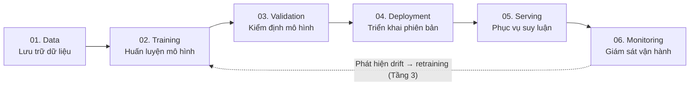
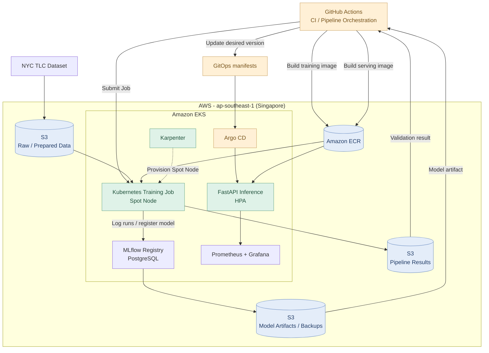
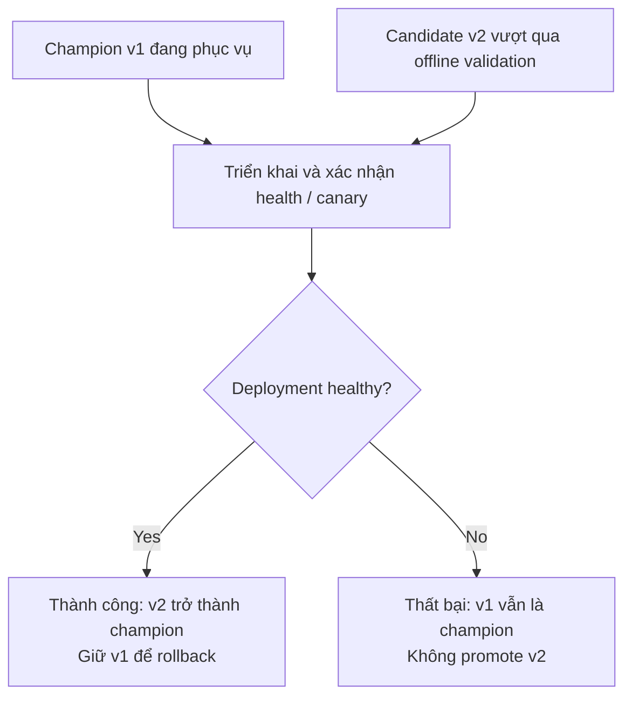
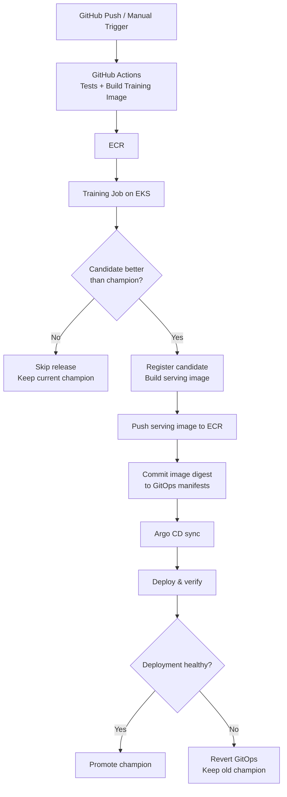
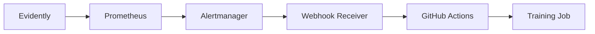
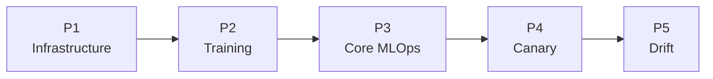

# Kế hoạch triển khai MLOps Platform on AWS — Proposal v1.0.1

> **Vai trò:** Technical Lead / Senior DevOps & MLOps Engineer
> **Nguồn yêu cầu:** Proposal version 1.0.1 — *MLOps Platform on AWS* (tài liệu PDF đính kèm).
> **Định hướng:** Triển khai hệ thống MLOps thực tế trên AWS, ưu tiên hoàn thiện luồng end-to-end trước khi bổ sung các khả năng tự động hóa nâng cao.

---

## 1. Phân tích requirements và phạm vi dự án

### 1.1. Mục tiêu chính

Theo mục 1.1–1.2 của proposal, dự án không tập trung phát triển một mô hình AI có độ chính xác cao nhất, mà tập trung xây dựng **nền tảng tự động quản lý vòng đời mô hình học máy trên AWS**.

Hệ thống cần bao quát sáu giai đoạn:



Bài toán minh họa được proposal xác định sẵn:

| Thành phần | Yêu cầu |
|---|---|
| Bài toán ML | Dự đoán thời gian di chuyển của taxi tại New York |
| Dataset | NYC TLC Trip Record Data, công bố theo tháng |
| Thuật toán | LightGBM |
| Hạ tầng | AWS, trọng tâm Amazon EKS |
| Tài nguyên huấn luyện | Kubernetes Job trên Spot Instance |
| Mục tiêu vận hành | Tự động hóa, quản lý phiên bản, CI/CD, autoscaling và monitoring |

Đây là những quyết định đã có trong proposal, không cần thay thế bằng một bài toán hoặc nền tảng khác.

*Nguồn: Proposal v1.0.1, mục 1.1–1.2 (trang nội dung 1–2).*

### 1.2. Phân loại scope chính thức

Proposal chia dự án thành ba tầng ưu tiên. Giữ nguyên sự phân chia này để xác định milestones và thứ tự triển khai.

| Tầng | Mức độ ưu tiên | Phạm vi | Kết quả kỳ vọng |
|---|---|---|---|
| **T1 — Core MLOps Pipeline** | **Bắt buộc** | Xử lý dữ liệu, huấn luyện, kiểm định, quản lý model bằng MLflow, triển khai API trên EKS, CI/CD, HPA, giám sát cơ bản. | Pipeline end-to-end hoạt động trên AWS, từ dữ liệu đến API suy luận. |
| **T2 — Progressive Delivery** | Mở rộng | Canary 10% → 100%, phân phối traffic đến hai phiên bản, tự rollback khi tỷ lệ lỗi hoặc độ trễ vượt ngưỡng. | Phát hành model mới có kiểm soát, bảo vệ phiên bản ổn định. |
| **T3 — Drift Detection & Automated Retraining** | Nâng cao | Evidently phát hiện drift, Alertmanager kích hoạt huấn luyện lại. | Monitoring có thể khởi động vòng đời model mới. |

**Quyết định về scope:** Hoàn thành Tầng 1 là điều kiện bắt buộc để coi mini-project đạt yêu cầu cốt lõi. Tầng 2 và Tầng 3 được triển khai theo thứ tự nếu còn thời gian và ngân sách. Không đánh đổi độ ổn định của Tầng 1 để bổ sung quá nhiều tính năng nâng cao.

*Nguồn: Proposal v1.0.1, mục 1.3 (trang nội dung 3).*

### 1.3. Những yêu cầu cần phân biệt

- **Model validation:** So sánh chất lượng candidate với champion. Chỉ model tốt hơn mới được đăng ký để xem xét phát hành.
- **Model deployment:** Model vượt qua validation vẫn phải được triển khai thành công mới trở thành champion đang phục vụ người dùng.
- **Infrastructure autoscaling:** HPA mở rộng số lượng Pod suy luận; cơ chế cấp phát thêm EC2 node là một vấn đề riêng và phải được thiết kế thêm.

Ngoài ra, proposal yêu cầu hạ tầng được quản lý bằng Terraform, có khả năng `make up` / `make down` mà vẫn bảo toàn dữ liệu S3, model artifacts và bản sao MLflow, thể hiện trong sơ đồ kiến trúc ở trang nội dung 2.

Đối với **seminar**, proposal quy định chủ đề so sánh Amazon SageMaker AI với hệ thống tự vận hành trên EKS. Phần bắt buộc là nghiên cứu và trình bày; thử nghiệm SageMaker endpoint và rollback là phần mở rộng. Vì vậy, **không triển khai SageMaker như một thành phần vận hành của mini-project**.

*Nguồn: Proposal v1.0.1, mục 2.1–2.3 (trang nội dung 4–6).*

---

## 2. Kiến trúc triển khai được đề xuất

### 2.1. Quyết định công nghệ

Chọn kiến trúc **Self-managed MLOps on Amazon EKS**, theo định hướng của proposal, nhưng bổ sung một số thành phần cần thiết để vận hành thực tế.

| Lớp | Công nghệ được chọn | Vai trò |
|---|---|---|
| Cloud Infrastructure | AWS, Terraform | Khởi tạo, quản lý, xóa tài nguyên |
| Container Orchestration | Amazon EKS | Vận hành các workload Kubernetes |
| Container Registry | Amazon ECR | Lưu Docker images |
| Data & Model Storage | Amazon S3 | Dataset, model artifacts, backups |
| Node Autoscaling | Karpenter | Cấp phát/thu hồi EC2 nodes |
| Training | Kubernetes Job, LightGBM | Huấn luyện trên CPU Spot Instance |
| Experiment & Registry | MLflow | Tracking, quản lý model versions |
| Metadata Database | PostgreSQL | Lưu metadata cho MLflow |
| Model Serving | FastAPI | REST API dự đoán thời gian |
| Pod Autoscaling | Kubernetes HPA | Tăng/giảm số Pod API |
| CI/CD | GitHub Actions | Test, build, điều phối và phát hành |
| GitOps | Argo CD | Đồng bộ trạng thái từ Git vào EKS |
| Progressive Delivery | Argo Rollouts, AWS ALB | Canary và rollback — Tầng 2 |
| Monitoring | Prometheus, Grafana | Metrics, dashboards |
| Drift & Alert | Evidently, Alertmanager | Phát hiện drift, kích hoạt retrain — Tầng 3 |

Trong số này, **Karpenter, PostgreSQL và AWS Load Balancer Controller/ALB là các quyết định thiết kế bổ sung**, không phải yêu cầu được ghi rõ trong proposal.

### 2.2. Sơ đồ kiến trúc tổng quan



> **Phạm vi sơ đồ:** Kiến trúc nền tảng Tầng 1. Argo Rollouts/ALB và Evidently/Alertmanager sẽ được tích hợp lần lượt ở Tầng 2 và Tầng 3.

### 2.3. Thiết kế hạ tầng AWS

Đề xuất cấu hình ban đầu:

- **Region:** `ap-southeast-1` (Singapore), phù hợp với sơ đồ proposal.
- **Networking:** Một VPC trải trên hai Availability Zones, gồm public subnets phục vụ thành phần public khi cần và private subnets chạy EKS worker nodes. Giai đoạn thử nghiệm dùng một NAT Gateway để giảm chi phí, chấp nhận đây chưa phải kiến trúc HA đầy đủ.
- **Compute:** Kết hợp một Managed Node Group On-Demand cho các service nền tảng và Karpenter với hai loại NodePool:
  - `training-spot`: Chỉ phục vụ training Jobs, tạo node khi cần và thu hồi khi hết workload.
  - `inference-on-demand`: Bổ sung node On-Demand khi các Pod serving không còn đủ tài nguyên để được schedule.

Karpenter được chọn vì có thể tạo và loại bỏ node theo nhu cầu scheduling của Pod, đồng thời hỗ trợ Spot và nhiều lựa chọn EC2 instance types.

**Hai cơ chế autoscaling khác nhau:**

| Cơ chế | Đối tượng | Tình huống minh họa |
|---|---|---|
| **HPA** | Số lượng Pod FastAPI | Tải CPU tăng → tăng replicas của FastAPI |
| **Karpenter** | EC2 worker nodes | Thiếu chỗ chạy Pod → tạo EC2 node mới |

Đối với dữ liệu và hạ tầng, tách Terraform thành hai phần:

| Phần | Thành phần | Khi `make down` |
|---|---|---|
| **Persistent** | S3 datasets, model artifacts, MLflow backups, Terraform state, ECR | Giữ lại |
| **Ephemeral** | VPC, EKS, EC2, ALB, EBS workload và các tài nguyên liên quan | Xóa sau khi backup |

MLflow dùng PostgreSQL một replica trên EKS để giảm chi phí, model artifacts được lưu trên S3. Trước khi xóa cluster, hệ thống phải backup PostgreSQL nhất quán lên S3 và có quy trình restore khi triển khai trở lại.

**Lưu ý:** S3 chỉ lưu model artifacts là chưa đủ để phục hồi MLflow Model Registry; registry còn phụ thuộc database metadata.

Đây là cấu hình phục vụ đồ án và demo, **không phải kiến trúc production HA** với nhiều replica, database managed và NAT Gateway riêng cho từng AZ.

---

## 3. Thiết kế các luồng vận hành

### 3.1. Data & Training Flow

**Luồng:** `Dataset → Preprocessing → Training → Validation → Model Registry`

Dữ liệu từ NYC TLC được tải theo tháng lên S3. Training Job đọc các tháng dữ liệu được chỉ định, làm sạch và chuyển thành bộ feature dùng cho LightGBM.

Chọn bộ feature ban đầu gồm `PULocationID`, `DOLocationID`, giờ nhận khách và ngày trong tuần. Nhãn dự đoán là thời lượng chuyến đi tính từ thời điểm đón đến trả khách.

Không dùng thời điểm trả khách, giá cước cuối chuyến hoặc các trường chỉ biết sau khi chuyến đi kết thúc làm input cho API, vì chúng gây rò rỉ thông tin tương lai.

Dataset được chia theo thời gian thành train, validation và test, thay vì random split toàn bộ. Mỗi lần huấn luyện phải lưu dataset version, code version, parameters và các metrics như MAE/RMSE trong MLflow.

Sau khi train xong:

1. Kiểm định candidate trên cùng một bộ đánh giá với champion.
2. Nếu candidate không tốt hơn champion, giữ experiment run nhưng không đăng ký model version mới.
3. Nếu tốt hơn, đăng ký candidate vào MLflow và xuất kết quả cho release pipeline.

Ngưỡng chấp nhận cụ thể sẽ được định nghĩa trong cấu hình; proposal chưa đưa ra con số RMSE/MAE bắt buộc.

### 3.2. Model Lifecycle

| Trạng thái | Ý nghĩa |
|---|---|
| **Model A — v1 / Champion** | Phiên bản đang phục vụ ổn định |
| **Model B — v2 / Candidate** | Phiên bản đã qua kiểm định offline, chờ phát hành |



MLflow sẽ sử dụng alias `champion` để trỏ đến phiên bản được xác nhận đang phục vụ. Aliases là cơ chế được MLflow hỗ trợ chính thức.

Chọn **đóng gói model artifact vào serving Docker image** sau khi candidate vượt qua validation. Mỗi image gắn với model version cố định và được phát hành qua ECR bằng image digest.

Cách này giúp FastAPI không phải tải lại model từ MLflow/S3 khi xử lý request, đồng thời đảm bảo rollback có thể quay về chính xác image và model trước đó.

### 3.3. CI/CD & GitOps Flow

GitHub Actions đảm nhiệm build và điều phối release; Argo CD là thành phần liên tục đồng bộ trạng thái ứng dụng trong cluster.



GitHub Actions sẽ dùng **OIDC để nhận AWS credentials ngắn hạn**, thay vì lưu AWS access key cố định. Quyền truy cập EKS được giới hạn bằng IAM role, EKS access entries và Kubernetes RBAC.

Trong Tầng 1, deployment dùng Kubernetes RollingUpdate thông thường. Sang Tầng 2, workload serving được chuyển sang Argo Rollouts.

### 3.4. Serving, Monitoring và Canary

FastAPI cung cấp các endpoint `/health`, `/ready`, `/predict` và `/metrics`. Prometheus thu thập các metrics như request count, HTTP error rate, latency histogram và tài nguyên CPU/memory; Grafana hiển thị dashboard.

HPA sử dụng CPU utilization để điều chỉnh số Pod FastAPI. Karpenter bổ sung EC2 khi không còn đủ tài nguyên để schedule Pod mới.

Đối với **Tầng 2**:

- AWS Load Balancer Controller quản lý ALB.
- Argo Rollouts điều chỉnh weighted target groups, ban đầu 90% stable và 10% canary.
- `AnalysisTemplate` truy vấn Prometheus để quyết định tiếp tục tăng tỷ lệ traffic hay abort.
- Sau khi thất bại, hệ thống phải khôi phục traffic về stable **và** hoàn nguyên desired version trong GitOps, để lần đồng bộ sau không tiếp tục triển khai candidate lỗi.

Argo Rollouts hỗ trợ traffic weighting qua ALB và abort tự động theo kết quả Prometheus.

### 3.5. Drift & Retraining Flow — Tầng 3

Evidently so sánh phân phối feature mới với tập reference từ dữ liệu huấn luyện. Kết quả được xuất thành metric cho Prometheus.

Khi metric vượt ngưỡng liên tục, Alertmanager gọi webhook receiver nội bộ. Receiver kiểm tra tính hợp lệ, trạng thái pipeline và cooldown, sau đó kích hoạt workflow huấn luyện trên GitHub Actions.



Có hai ràng buộc cần lưu ý:

- Phát hiện drift không đồng nghĩa model chắc chắn giảm chất lượng.
- Chỉ retrain khi có dữ liệu nhãn mới phù hợp. Candidate được tạo ra vẫn phải vượt qua validation trước khi được phát hành.

Vì dự án không yêu cầu huấn luyện trực tuyến, chọn drift detection dạng batch theo cửa sổ dữ liệu thay vì xử lý streaming thời gian thực.

---

## 4. Implementation Roadmap

Đề xuất chia việc triển khai thành **5 phases chính**, tương ứng 5 milestones. Mỗi phase tạo ra một kết quả có thể chạy, kiểm chứng và làm nền tảng cho phase tiếp theo.



**P1 → P2 → P3** hoàn thành Tầng 1. **P4** và **P5** lần lượt hoàn thành Tầng 2 và Tầng 3.

### Phase 1 — AWS Infrastructure Foundation

**Milestone M1**

**Mục tiêu:** Có một môi trường AWS/EKS được quản lý hoàn toàn bằng Infrastructure as Code, có thể tạo, xóa và tái tạo.

| Nội dung | Kết quả mong đợi |
|---|---|
| Dependencies | AWS account, quyền IAM, GitHub repository, ngân sách |
| Implementation | Terraform, VPC, EKS, Managed Node Group, Karpenter, S3, ECR, IAM, GitHub OIDC, Argo CD bootstrap |
| Deliverables | Terraform modules, bootstrap scripts, `Makefile`, cấu hình AWS dev environment |
| Verification | `make up` tạo cluster thành công; `kubectl` truy cập EKS; Karpenter provision được node; `make down` dọn hạ tầng mà vẫn giữ persistent storage |

**Điều kiện hoàn thành M1:** Hạ tầng có thể tái tạo từ repository, không phải cấu hình thủ công từng resource bằng AWS Console.

### Phase 2 — Data & Model Training Pipeline

**Milestone M2**

**Mục tiêu:** Dữ liệu thực được xử lý và huấn luyện bằng Kubernetes Job trên Spot node, kết quả được kiểm định và quản lý bằng MLflow.

| Nội dung | Kết quả mong đợi |
|---|---|
| Dependencies | M1 |
| Implementation | NYC TLC ingestion, preprocessing, LightGBM, Training Job, MLflow, PostgreSQL, validation gate |
| Deliverables | Training image, dataset pipeline, model registry, evaluation reports, MLflow backup/restore |
| Verification | Job khởi chạy thành công trên Spot node, logs/metrics xuất hiện trong MLflow, candidate tốt hơn được đăng ký và candidate kém hơn bị từ chối |

**Điều kiện hoàn thành M2:** Có ít nhất một model hợp lệ và có thể tái hiện quá trình huấn luyện; Spot node được thu hồi khi không còn workload; metadata và artifacts khôi phục được từ backup.

### Phase 3 — Automated Deployment, Serving & Observability

**Milestone M3 — Core Complete**

**Mục tiêu:** Kết nối kết quả training với hệ thống serving, hoàn thiện CI/CD, GitOps, autoscaling và monitoring.

| Nội dung | Kết quả mong đợi |
|---|---|
| Dependencies | M1 + M2 |
| Implementation | FastAPI, serving image, GitHub Actions, Argo CD, Kubernetes Deployment, HPA, Prometheus, Grafana |
| Deliverables | REST API trên EKS, CI/CD workflows, GitOps manifests, dashboards, load testing scripts |
| Verification | Candidate được chấp nhận → tự build image → cập nhật GitOps → Argo CD triển khai → API phục vụ model mới; HPA tăng/giảm Pod theo tải |

**Điều kiện hoàn thành M3:** Toàn bộ quy trình cốt lõi chạy end-to-end, không phải triển khai model thủ công từng bước.

> **Checkpoint quan trọng nhất của project:** Khi hoàn thành M3, dự án đã đáp ứng phạm vi bắt buộc của proposal. Cần dành thời gian kiểm thử, ổn định, thu thập evidence và kiểm chứng khả năng khôi phục hệ thống trước khi triển khai các phase nâng cao.

### Phase 4 — Canary Deployment & Automated Rollback

**Milestone M4 — Tier 2 Complete**

**Mục tiêu:** Triển khai phiên bản model mới theo tỷ lệ traffic tăng dần, tự động khôi phục phiên bản cũ khi metrics bất thường.

| Nội dung | Kết quả mong đợi |
|---|---|
| Dependencies | M3 |
| Implementation | AWS Load Balancer Controller, ALB, Argo Rollouts, Prometheus AnalysisTemplate |
| Deliverables | Canary manifests, traffic routing, automated rollback, failure injection tests |
| Verification | Quan sát phân phối 90/10 bằng request thực; tăng traffic lên 100% khi đạt yêu cầu; chủ động tạo lỗi và chứng minh rollback không cần thao tác thủ công |

**Điều kiện hoàn thành M4:** Hệ thống bảo vệ được phiên bản stable trước một candidate không đạt chỉ số vận hành, đồng thời duy trì đúng trạng thái trong GitOps sau rollback.

### Phase 5 — Drift Detection & Automated Retraining

**Milestone M5 — Tier 3 Complete**

**Mục tiêu:** Khép kín model lifecycle bằng cơ chế nhận diện drift và khởi động pipeline huấn luyện lại.

| Nội dung | Kết quả mong đợi |
|---|---|
| Dependencies | M3 và M4 |
| Implementation | Evidently, drift reports, Prometheus metrics, Alertmanager, webhook trigger |
| Deliverables | Drift detection Job, alert rules, retraining trigger, kiểm soát duplicate/cooldown |
| Verification | Dữ liệu bị dịch chuyển phân phối → phát hiện drift → alert → training Job khởi chạy; candidate mới vẫn phải vượt qua validation trước khi được phát hành |

**Điều kiện hoàn thành M5:** Chứng minh được một vòng đời khép kín từ monitoring đến retraining và triển khai lại, có kiểm soát lỗi và tránh kích hoạt lặp vô hạn.

---

## 5. Cấu trúc repository

Sử dụng **monorepo** để quản lý source code, infrastructure, Kubernetes manifests và CI/CD cùng nhau. Đây là phương án phù hợp với quy mô bài tập lớn.

```text
mlops-platform-aws/
├── .github/
│   └── workflows/           # CI, training, release
│
├── src/
│   ├── training/            # Data processing, LightGBM
│   ├── inference/           # FastAPI, model serving
│   ├── drift/               # Evidently - Tier 3
│   └── retrain_trigger/     # Webhook receiver - Tier 3
│
├── infra/
│   └── terraform/
│       ├── persistent/      # S3, ECR, state
│       └── platform/        # VPC, EKS, IAM, compute
│
├── deploy/
│   ├── bootstrap/           # Initial cluster services
│   ├── platform/            # Helm values
│   └── gitops/              # Argo CD application configs
│
├── tests/
│   ├── unit/
│   ├── integration/
│   └── load/
│
├── scripts/                 # Automation, backup, restore
├── docs/                    # Architecture, runbooks, evidence
├── Makefile
└── README.md
```

**Nguyên tắc phân chia trách nhiệm:**

- `infra/`: Terraform quản lý AWS resources.
- `deploy/`: Argo CD và Kubernetes quản lý các service chạy trên cluster.
- `src/`: Triển khai ứng dụng và logic MLOps.
- `.github/workflows/`: Tự động hóa kiểm thử, build và release.

Tránh để Terraform và Argo CD cùng sở hữu một Kubernetes resource, vì điều này dễ dẫn đến xung đột trạng thái.

---

## 6. Các rủi ro kỹ thuật cần kiểm soát

| Rủi ro | Quyết định xử lý |
|---|---|
| Chi phí AWS phát sinh | Dùng Budget alerts, hạ tầng ephemeral, kiểm tra resource sau mỗi lần `make down` |
| Spot Instance bị AWS thu hồi | Job có retry và timeout; không phát hành khi training chưa hoàn thành |
| MLflow mất model metadata | S3 lưu artifacts; PostgreSQL được backup và restore độc lập |
| GitHub Actions không kết nối được EKS | Thiết kế rõ đường truy cập Kubernetes API, IAM và RBAC ngay ở M1 |
| HPA tăng Pod nhưng thiếu EC2 capacity | Sử dụng Karpenter để provision node |
| Canary không đạt tỷ lệ thực tế | Dùng ALB weighted target groups thay vì chỉ chia số replicas |
| Thiếu traffic để đánh giá canary | Dùng load testing và yêu cầu lượng mẫu tối thiểu trước khi quyết định |
| Drift không xảy ra rõ trong thời gian demo | Sử dụng thêm dữ liệu có phân phối thay đổi có kiểm soát để kiểm thử |

Về chi phí, Amazon EKS tính **0,10 USD/giờ cho cluster ở standard support** (tương đương 2,40 USD/ngày nếu cluster chạy liên tục), chưa bao gồm EC2, NAT Gateway, ALB, EBS và những dịch vụ khác. Cần kiểm tra bảng giá AWS tại thời điểm thực hiện. Vì vậy, không nên để môi trường chạy 24/7 ngoài thời gian thực hành.

Một điểm đặc biệt quan trọng là triển khai `make down` phải có thứ tự dọn dẹp đúng: backup dữ liệu trước, xóa các thành phần Kubernetes tạo AWS resources như ALB và Karpenter-managed nodes, sau đó mới destroy EKS/VPC. Nếu không, có nguy cơ để lại tài nguyên AWS phát sinh chi phí.

---

## 7. Tiêu chí nghiệm thu tổng thể

Các tiêu chí dưới đây là **Definition of Done đề xuất để kiểm chứng proposal**, không phải bộ chỉ số định lượng đã được giảng viên quy định.

### Tầng 1 — Core MLOps

- [ ] Pipeline huấn luyện thực sự chạy trên EKS Spot node.
- [ ] MLflow quản lý được model versions và champion.
- [ ] Candidate không đạt validation không được phát hành.
- [ ] GitHub Actions + Argo CD triển khai được serving image mới.
- [ ] FastAPI hoạt động; HPA có bằng chứng scale-out và scale-in.
- [ ] Prometheus/Grafana hiển thị request metrics và tài nguyên.
- [ ] Hạ tầng có thể destroy/recreate, dữ liệu và Registry phục hồi được.

### Tầng 2 — Progressive Delivery

- [ ] ALB phân phối traffic stable/canary theo cấu hình 90/10.
- [ ] Canary thành công được promote lên 100%.
- [ ] Canary lỗi bị abort/rollback dựa trên metrics.
- [ ] GitOps desired state và champion được đồng bộ đúng.

### Tầng 3 — Automated Retraining

- [ ] Evidently phát hiện được drift từ batch dữ liệu.
- [ ] Alert tự động kích hoạt training workflow.
- [ ] Không tạo trùng training Jobs khi alert lặp.
- [ ] Model mới vẫn tuân thủ validation và release gates.

Mỗi milestone cần lưu evidence như log GitHub Actions, trạng thái Kubernetes, MLflow runs, biểu đồ Grafana, rollout analysis và kết quả kiểm thử vào `docs/evidence/`. Đây sẽ là cơ sở để nhóm viết báo cáo và demo với giảng viên.
