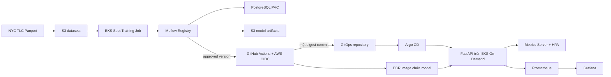

# MLOps Platform on AWS

Nền tảng MLOps dự đoán **thời lượng chuyến NYC Yellow Taxi** từ điểm đón, điểm trả và thời gian đón. Dự án đi từ dữ liệu Parquet đến LightGBM, MLflow Model Registry, image FastAPI, GitHub Actions release, Argo CD và monitoring trên Amazon EKS. [Proposal/Implementation Plan v1.0.1](MLOps_AWS_Implementation_Plan_v1.0.1.md) định nghĩa phạm vi năm Phase. **Phase 1–3 đã triển khai trên môi trường dev**; Phase 4–5 chưa triển khai.

## Kiến trúc



Training dùng tháng 2025-01/02 cho train, 2025-03 validation và 2025-04 test. Validation gate chỉ chấp thuận candidate đủ điều kiện. Release workflow nhận **model name/version rõ ràng**, trực tiếp lấy approved model từ cloud Registry, kiểm tra bundle, build/push image và commit ECR digest. Argo CD tự triển khai; runner kiểm chứng API rồi mới xác nhận alias `champion`. Dispatch release **không tự train**. Image chứa model và feature contract nên request inference không cần gọi MLflow/S3.

Terraform tách ba state: bootstrap state bucket (state local phải sao lưu riêng), persistent S3/ECR, và platform VPC/EKS/IAM/add-ons. Xóa platform không đồng nghĩa xóa persistent storage; PostgreSQL PVC cần backup trước khi teardown.

## Công nghệ và repository

| Nhóm | Công nghệ và nguồn version |
| --- | --- |
| Training/serving | Python 3.12, LightGBM, MLflow 3.6, FastAPI, Pydantic, Uvicorn; `pyproject.toml` và `uv.lock` |
| Cloud | AWS EKS, EC2, EBS, S3, ECR, IAM, VPC; Terraform 1.16.6 và provider/module trong `infra/terraform/` |
| Delivery | Docker, Kubernetes, Karpenter, GitHub Actions OIDC, Argo CD |
| Quan sát | Metrics Server, HPA, Prometheus, Grafana, k6; Helm values và scripts trong `deploy/`, `scripts/` |

```text
src/training/       xử lý dữ liệu, features, LightGBM, MLflow, validation gate
src/inference/      release bundle, export, model loading, FastAPI, metrics
configs/            cấu hình ứng dụng
infra/terraform/    bootstrap, persistent, platform
deploy/             Dockerfiles, Kubernetes/GitOps, Helm values, dashboard
scripts/            build, deploy, verification, backup và cleanup
tests/              unit/integration tests
docs/               setup, operations, kiến trúc, tài liệu năm Phase, evidence
docs/_local/         ghi chú phát triển local, Git-ignored; phải backup riêng
```

## Điều kiện trước khi bắt đầu

Cần Ubuntu/Linux, Python 3.12, uv, Git, Make, Docker, AWS CLI v2, Terraform 1.16.6, kubectl, Helm và GitHub CLI. AWS account cần quyền tạo S3/ECR/VPC/EKS/IAM/EC2/Pod Identity, quota và ngân sách; GitHub repository cần Actions/OIDC. EKS API dev chỉ cho phép IPv4 quản trị dạng `/32`, nên IP egress thay đổi có thể khiến kubectl timeout.

**Quan trọng cho người clone:** OIDC trust, workflow, ECR digest, Argo CD repoURL và một số scripts hiện gắn với account/repository dev gốc. [Setup](docs/setup.md#cấu-hình-cho-aws-account-và-github-repository-khác) liệt kê các chỗ phải cấu hình trước khi triển khai trên account khác. Không chạy workflow release hoặc apply serving manifest chứa image account cũ trên account mới. Các biến `AWS_PROFILE`, `AWS_REGION`, `TF_VAR_eks_public_access_cidrs`, `MLFLOW_DB_PASSWORD` và `GRAFANA_ADMIN_PASSWORD` được giải thích trong setup.

## Bắt đầu từ đầu

Đọc [hướng dẫn setup](docs/setup.md) và `make help` trước khi chạy. Các lệnh apply, push, train và load test dưới đây tạo tài nguyên hoặc tiêu thụ tài nguyên tính phí; review Terraform plan và thông tin account ở từng bước. Trên account mới, hoàn tất checklist identity trong setup trước khi triển khai release.

```bash
git clone https://github.com/HaiXon231/mlops-platform-aws.git
cd mlops-platform-aws
make training-setup
make check
export AWS_PROFILE=mlops-dev  # Đổi thành profile của bạn trên account khác.
export AWS_REGION=ap-southeast-1
aws sts get-caller-identity

make tf-bootstrap-init
make tf-bootstrap-plan
make tf-bootstrap-apply
make tf-persistent-init
make tf-persistent-plan
make tf-persistent-apply
export TF_VAR_eks_public_access_cidrs="$(printf '["%s/32"]' "$(curl -4fsS https://checkip.amazonaws.com)")"
make tf-platform-init
make tf-platform-plan
make tf-platform-apply
aws eks update-kubeconfig --profile "$AWS_PROFILE" --region "$AWS_REGION" --name mlops-aws-dev
make k8s-bootstrap
make k8s-verify
```

Tên cluster `mlops-aws-dev` ứng với `environment=dev`. Đổi region/environment đòi hỏi review backend, AZ, manifests và scripts; đổi mỗi `TF_VAR_aws_region` là chưa đủ. Sao lưu `infra/terraform/bootstrap/terraform.tfstate` an toàn ngoài Git.

```bash
make data-download
make training-test
make cloud-images-build
make cloud-images-push
make cloud-data-sync
read -rsp 'New cloud MLflow DB password: ' MLFLOW_DB_PASSWORD; echo
export MLFLOW_DB_PASSWORD
make cloud-deploy
unset MLFLOW_DB_PASSWORD
make cloud-verify
make cloud-train
VERIFY_TRAINING=1 make cloud-verify
```

`cloud-train` tạo Kubernetes Job trên Spot và dùng pipeline/gate hiện có. `make train-local` và `make mlflow-up` là lựa chọn phát triển local, không tự đồng bộ Registry local lên cloud. Account cần service-linked role EC2 Spot trước lần Spot đầu tiên; xem [Phase 1](docs/phases/phase-01.md).

Serving lần đầu cần approved Registry version, ECR image và digest thật trong `deploy/gitops/inference/deployment.yaml`. Mở cloud MLflow port-forward ở một terminal, rồi export/build/push ở terminal khác:

```bash
make m23-port-forward
make serving-export MLFLOW_TRACKING_URI=http://127.0.0.1:5000
make serving-build
make serving-push
make serving-manifest-check
```

`serving-push` in URI@digest nhưng không deploy. Thay ECR URI/digest và model version trong manifest; chỉnh Argo CD `repoURL` theo repository thật. Áp dụng `deploy/argocd/inference-application-manual.yaml`, so sánh desired/live, sau đó mới chuyển sang `inference-application-automated.yaml`. Với Deployment đang chạy thủ công, dùng adoption check trong [Phase 3](docs/phases/phase-03.md); không để Argo CD và kubectl apply cùng quản lý serving. Sau bootstrap một lần, release chuẩn dùng:

```bash
make release-test
make release-run M31_MODEL_NAME=nyc-taxi-trip-duration M31_MODEL_VERSION=1
make release-gitops-verify
```

Chỉ dispatch khi GitHub OIDC role, repository identity, EKS Access Entry/RBAC, runner network và branch protection đã đúng. Workflow hiện vẫn gắn với identity dev gốc; xem setup trước khi dùng trên fork/account mới.

HPA thuộc GitOps. Sau khi Argo CD Application đã có `ignoreDifferences` cho `spec.replicas` và Metrics Server add-on được Terraform áp dụng, cài monitoring:

```bash
helm repo add prometheus-community https://prometheus-community.github.io/helm-charts
helm repo add grafana-community https://grafana-community.github.io/helm-charts
helm repo update
make monitoring-test
read -rsp 'New Grafana admin password: ' GRAFANA_ADMIN_PASSWORD; echo
export GRAFANA_ADMIN_PASSWORD
make monitoring-deploy
unset GRAFANA_ADMIN_PASSWORD
make monitoring-verify
```

Hướng dẫn setup trình bày thứ tự áp dụng Argo CD Application, Secret và kiểm tra trước khi tạo HPA; không cài Metrics Server lần hai bằng Helm.

## Sử dụng và kiểm chứng

```bash
kubectl -n mlops port-forward service/inference-api 8000:8000
curl -fsS http://127.0.0.1:8000/readyz
curl -fsS http://127.0.0.1:8000/model-info
curl -fsS -H 'Content-Type: application/json' \
  -d '{"pickup_location_id":1,"dropoff_location_id":2,"pickup_datetime":"2025-04-07T16:00:00Z"}' \
  http://127.0.0.1:8000/predict
kubectl -n mlops get hpa inference-api
kubectl get nodeclaims
```

`/predict` yêu cầu timezone; API chuyển timestamp sang `America/New_York` trước feature engineering. `/healthz` là liveness, `/readyz` chỉ Ready khi model load thành công, `/metrics` xuất Prometheus metrics, `/docs` là Swagger. MLflow: `make m23-port-forward` (cổng 5000). Argo CD: `make argocd-port-forward` (HTTPS cổng 8080). Prometheus/Grafana: xem [operations](docs/operations.md). UI không có public Ingress/ALB.

## Tiến độ năm Phase

| Phase | Mục tiêu | Trạng thái |
| --- | --- | --- |
| [1 — Infrastructure](docs/phases/phase-01.md) | Terraform, VPC/EKS, Karpenter, Argo CD, persistent resources | Đã triển khai dev |
| [2 — Training & Registry](docs/phases/phase-02.md) | NYC Taxi, LightGBM, Spot Job, MLflow, backup/restore | Đã triển khai dev |
| [3 — Serving & Observability](docs/phases/phase-03.md) | FastAPI, release, GitOps, HPA, monitoring | Đã triển khai dev |
| [4 — Canary & Rollback](docs/phases/phase-04.md) | Progressive delivery và rollback theo metric | Chưa triển khai |
| [5 — Drift & Retraining](docs/phases/phase-05.md) | Batch drift, alert và retraining có gate | Chưa triển khai |

Training artifact local được ghi nhận có validation MAE **3,8372 phút** và test MAE **4,1301 phút** trên mỗi tập 100.000 dòng đã lấy mẫu. Cloud Registry có approved model version 1; GitHub Actions đã tạo digest-pinned image và Argo CD triển khai. Bài k6 gửi **55.398 requests, 0 HTTP failures**; HPA scale **1→3→1** Pods. [Evidence theo Phase](docs/evidence/) nêu nguồn số liệu và giới hạn kiểm chứng.

## Chi phí, cleanup và giới hạn

EKS control plane, NAT Gateway/EIP, EC2 system/Spot/On-Demand, EBS PVC, S3/ECR storage/requests, logs và data transfer có thể tính phí. `make cloud-backup` và `make cloud-restore-check BACKUP_KEY=...` kiểm tra dữ liệu trước khi dọn. `make monitoring-cleanup` gỡ monitoring; **`make cloud-teardown` backup rồi xóa cả namespace `mlops`, bao gồm inference đang chạy** nên phải gỡ Argo CD Application/serving có kiểm soát trước. `make tf-platform-down` yêu cầu xác nhận và chỉ destroy platform state sau cleanup. Không xóa persistent S3/ECR, bootstrap state hoặc training/model artifacts khi chưa có bản sao. Xem thứ tự an toàn trong [operations](docs/operations.md).

Giới hạn: một NAT và PostgreSQL một replica/PVC chưa HA; một số dataset cache cũ có `source_verified=false`; Prometheus giữ metrics 24 giờ trên `emptyDir`; load test chứng minh scale replicas nhưng chưa chứng minh throughput tăng nhờ các Pod mới; release trên account/repo khác cần migration cấu hình identity và kiểm thử lại. Phase 4–5 chưa triển khai.
