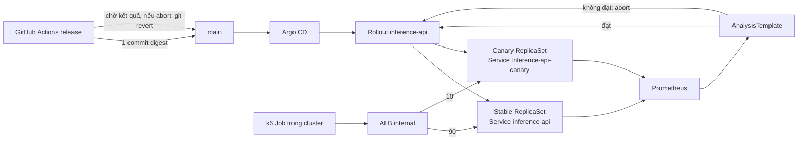

# Phase 4 — Thiết kế Canary Deployment & Automated Rollback

**Trạng thái: bản thiết kế, chưa triển khai.** Tài liệu này chốt kiến trúc, quyết định và kế hoạch thực hiện cho [Phase 4](phase-04.md). Mọi manifest/đoạn code bên dưới là phác thảo, chưa được chạy hoặc kiểm chứng trên cluster.

## 1. Mục tiêu và tiêu chí hoàn thành (M4)

Theo [Proposal v1.0.1](../../MLOps_AWS_Implementation_Plan_v1.0.1.md): phát hành model mới theo tỷ lệ traffic tăng dần và tự khôi phục stable khi metric vận hành xấu. Hoàn thành khi chứng minh được:

1. Phân phối **90/10** quan sát được bằng request thực.
2. Candidate đạt metric → tăng lên **100%** không cần thao tác tay.
3. Candidate bị lỗi cố ý → **rollback tự động**, không cần thao tác tay.
4. Sau rollback, **GitOps (`main`) trở lại đúng stable digest** và alias `champion` không bị đổi.

Không thay đổi validation gate của Phase 2. Canary là kiểm tra **vận hành**, không đánh giá lại chất lượng model.

## 2. Hiện trạng liên quan (đã kiểm tra trong repo/cluster)

| Điểm | Hiện trạng | Hệ quả cho Phase 4 |
| --- | --- | --- |
| Workload | `Deployment inference-api` + `Service` ClusterIP + HPA (CPU 60%, 1–3) | Phải chuyển sang `Rollout`, HPA trỏ lại |
| Release | `scripts/m32_release.sh`: build → ECR digest → **một** commit vào `main` → chờ Argo → `m32_verify.py` → promote `champion` | Phải chờ kết quả canary, xử lý rollback, promote muộn hơn |
| `m32_verify.py` | `workload_matches` đọc `Deployment`, đòi mọi Pod cùng một image | Sẽ sai khi có 2 ReplicaSet; phải viết lại cho `Rollout` |
| Metrics | App xuất `inference_http_requests_total`, `inference_http_errors_total`, `inference_http_request_duration_seconds`, `inference_model_info` | Đủ cho error-rate và latency; không cần sửa app |
| Prometheus | 1 server, ephemeral, chỉ scrape Pod label `app=inference-api`, **chưa giữ label hash của ReplicaSet** | Phải thêm relabel để tách canary/stable |
| Mạng | Public subnet có `kubernetes.io/role/elb`, private có `internal-elb` | Tag subnet cho ALB đã sẵn |
| Tải k6 (Phase 3) | `K6_VUS` và `K6_DURATION` là biến gốc của k6 và ghi đè toàn bộ `scenarios`, nên `constant-arrival-rate` bị bỏ qua (log: `"env" level configuration overrode scenarios configuration entirely`). Các bài tải Phase 3 thực chất là vòng lặp kín theo số VU, không phải tốc độ cố định | Đã đổi sang `LOAD_VUS/RATE/DURATION/BASE_URL`; từ nay `M33_RATE` có hiệu lực. Số liệu Phase 3 (ví dụ 55.398 request) không so sánh trực tiếp được với tải theo tốc độ cố định |
| Node `system` | `t3.large`, desired 1, max 2, **CPU requests ~91%** | LB Controller + Argo Rollouts sẽ không vừa; cần tăng `desired_size` lên 2 |
| IAM | Pod Identity (không IRSA) cho Karpenter/MLflow/training | LB Controller dùng cùng kiểu |
| Argo CD | Application `automated`, `selfHeal=true`, `prune=false` | Phải cập nhật `ignoreDifferences` cho `Rollout` |

## 3. Quyết định kiến trúc

### D1. Chia traffic: Argo Rollouts + ALB (đúng proposal)
Chọn **AWS Load Balancer Controller + ALB + Argo Rollouts** với `trafficRouting.alb`. Weight do ALB đặt giữa hai Service nên 90/10 chính xác kể cả khi chỉ có 1 Pod mỗi bên.

Đã loại: chia theo số replica (không ra 90/10 với 1–3 Pod, không đáp ứng tiêu chí 1); service mesh/NGINX (thêm thành phần ngoài proposal).

### D2. ALB **internal**, kiểm thử bằng k6 trong cluster
`alb.ingress.kubernetes.io/scheme: internal` (private subnet). Lý do: không mở endpoint ra Internet và tránh vấn đề IP quản trị đổi liên tục của người vận hành. Traffic thật cho analysis đến từ **k6 Job trong cluster** (đã có `deploy/monitoring/k6-job.yaml.tpl`), gọi DNS nội bộ của ALB. `target-type: ip`.

Đánh đổi: không gọi thử từ máy cá nhân qua ALB; dùng `kubectl port-forward` vào Service cho kiểm tra tay.

### D3. Quan hệ Service
- `inference-api` giữ nguyên tên và làm **stableService** để không phá `m32_verify`, port-forward và k6.
- Thêm `inference-api-canary` làm canaryService.
- Rollouts tự quản selector của hai Service theo hash ReplicaSet.

### D4. Rollout nhận Deployment qua `workloadRef`
`Rollout inference-api` dùng `workloadRef` trỏ vào `Deployment inference-api` hiện có (`scaleDown: onsuccess`) thay vì thay thế nó. Nhờ vậy `deployment.yaml` vẫn là nơi duy nhất release sửa, và `m32_gitops.py`, `m31-validate-manifest.py` không phải đổi. HPA `scaleTargetRef` đổi sang `argoproj.io/v1alpha1 Rollout`. Application thêm `ignoreDifferences` `/spec/replicas` cho `Rollout` (Deployment đã có sẵn).

Hệ quả: Deployment sẽ về 0 replica sau khi Rollout Healthy, nên `m32_verify.py` và `m33.sh` (đọc replica từ Deployment) phải đọc từ `Rollout`.

### D5. Quy trình bước canary

| Bước | Hành động | Cổng |
| --- | --- | --- |
| 0 | Canary 1 Pod, **weight 0** | Pod Ready + smoke Job gọi `/model-info`, `/predict` trực tiếp vào `inference-api-canary` (đúng model version/digest dự kiến) |
| 1 | `setWeight: 10` | Pause 2 phút, AnalysisRun chạy nền |
| 2 | `setWeight: 50` | Pause 2 phút, AnalysisRun |
| 3 | `setWeight: 100` (promote) | Rollout Healthy, stable = canary |

Bước 0 là kiểm tra trước khi nhận traffic thật, giúp lỗi "model/bundle sai" không chạm người dùng. Số bước và thời gian chỉnh được trong manifest để rút ngắn khi demo.

### D6. Metric gate (AnalysisTemplate, Prometheus provider)
Nguồn: `http://m33-prometheus-server.monitoring.svc.cluster.local:80`. Tách canary bằng label `rollouts_pod_template_hash` (thêm relabel từ `__meta_kubernetes_pod_label_rollouts_pod_template_hash`; Rollouts truyền hash qua `args` kiểu `podTemplateHashValue: Latest`).

| Gate | Phác thảo truy vấn | Điều kiện đạt |
| --- | --- | --- |
| Tỷ lệ lỗi | `sum(rate(inference_http_errors_total{path="/predict",rollouts_pod_template_hash="$H"}[1m])) / sum(rate(inference_http_requests_total{path="/predict",rollouts_pod_template_hash="$H"}[1m]))` | `< 1%` |
| Độ trễ p95 | `histogram_quantile(0.95, sum by (le)(rate(inference_http_request_duration_seconds_bucket{path="/predict",...canary}[1m])))` | `< 500 ms` **và** `<= 1.5 × p95 của stable + 50 ms` |
| Có traffic | tổng request canary trong cửa sổ | `>= N` (mặc định 50); thiếu mẫu → *inconclusive*, không tính là đạt |

Cấu hình: `interval 30s`, `count 5`, `failureLimit 1`, `inconclusiveLimit 2`. Ngưỡng khởi điểm dựa trên bài k6 của Phase 3 (p95 880 ms khi CPU bão hòa) nên cần **hiệu chỉnh bằng baseline đo thật** ở bước M4.5 trước khi chốt.

Lưu ý: `inference_http_errors_total` đếm mọi status `>= 400`, gồm cả 4xx. Traffic kiểm thử phải hợp lệ để 4xx không làm lệch gate.

## 4. Kiến trúc

## 5. Rollback và GitOps nhất quán

Vấn đề cốt lõi: khi Rollouts **abort**, cluster quay về stable nhưng `main` vẫn chứa digest xấu (Argo vẫn `Synced`, Rollout ở trạng thái `Degraded/Aborted`). Nếu không xử lý, GitOps nói dối.

Quyết định: **workflow release sở hữu việc đồng bộ lại Git**, không thêm controller mới.

1. Sau khi push commit release (như hiện nay), workflow chờ Rollout đạt một trong hai trạng thái cuối: `Healthy` (đã promote 100%) hoặc `Degraded` do abort.
2. Nếu abort: `git revert --no-edit <release-commit>` rồi push `main` (một commit revert có thể truy vết), workflow **fail** và **không** promote `champion`.
3. Argo sync commit revert → template Pod trở lại đúng stable → Rollout hội tụ ngay (không canary mới).
4. Nếu đạt: giữ nguyên luồng cũ — verify API ở 100% rồi mới promote `champion` (idempotent).

Bất biến cần giữ: `champion` chỉ đổi sau khi version mới phục vụ 100%; mọi thay đổi `main` do release là **một** commit (hoặc đúng một commit revert đi kèm). Nếu push revert bị `main` từ chối (branch protection, xung đột), workflow báo lỗi rõ ràng và để người vận hành xử lý; cluster vẫn an toàn vì stable đang phục vụ.

Trường hợp Argo selfHeal: sau abort, đừng sửa `Rollout` bằng tay, vì Argo sẽ đưa lại spec từ Git.

## 6. Thay đổi theo thành phần

### 6.1 Terraform (`infra/terraform/platform/`) — chỉ `plan`, không tự apply
- IAM policy + role + `aws_eks_pod_identity_association` cho `aws-load-balancer-controller` (theo mẫu `mlops.tf`).
- `system` node group: `desired_size` và `min_size` lên 2 (đã có `max_size = 2`).
- Kiểm tra security group của node cho phép ALB → Pod (`target-type: ip`).
- Output mới nếu cần cho script/workflow.

### 6.2 Add-on (Helm, theo kiểu `deploy/platform/`)
- `deploy/platform/aws-load-balancer-controller-values.yaml` (1 replica, request nhỏ, tham chiếu cluster name/VPC).
- `deploy/platform/argo-rollouts-values.yaml` (controller 1 replica, bật metrics).
- Cài thêm trong `scripts/k8s-bootstrap.sh` (hoặc script riêng `scripts/m4x.sh`), version chart được pin như các add-on khác.

### 6.3 Manifest GitOps (`deploy/gitops/inference/`)
- `deployment.yaml` **giữ nguyên** (Pod template, annotation release); thêm `rollout.yaml` với `workloadRef`. **Đã làm.**
- `service.yaml` thêm `inference-api-canary`.
- `ingress.yaml` (ALB internal) + annotation action do Rollouts quản lý.
- `analysis-template.yaml` (gate ở §3 D6) và smoke Job template.
- `hpa.yaml` trỏ tới `Rollout`; `kustomization.yaml` cập nhật.
- `deploy/argocd/inference-application-*.yaml`: `ignoreDifferences` thêm `Rollout`.
- `scripts/m31-validate-manifest.py` và `scripts/m32_gitops.py` **không cần đổi** nhờ `workloadRef` (vẫn đọc/sửa `deployment.yaml`).

### 6.4 Monitoring
- `prometheus-values.yaml`: thêm relabel `rollouts_pod_template_hash`.
- Dashboard Grafana: thêm panel so sánh stable/canary (request rate, lỗi, p95) và đánh dấu weight.
- `k6-job.yaml.tpl`/`k6.js`: tham số URL đích (ALB DNS) và tốc độ, vẫn nằm trong giới hạn `M33_VUS<=50`, `M33_RATE<=200`.

### 6.5 Release (`scripts/` và `.github/workflows/m32-release.yml`)
- `m32_release.sh`: sau push, chờ Rollout; nhánh abort → revert (§5).
- `m32_verify.py`: `workload_matches` đọc `Rollout`, kiểm tra stable = image mong đợi, không còn canary, cho phép nhiều ReplicaSet trong lúc rollout.
- Quyền RBAC cho runner (`deploy/bootstrap/m32-github-release-rbac.yaml`): thêm `rollouts`/`analysisruns` (get/list/watch).
- Runner đang truy cập API EKS bằng `/32` tạm thời; thời gian chờ canary kéo dài làm cửa sổ này dài hơn, cần kiểm tra timeout `m32_eks_cidr.py` (hiện 1200 s).

### 6.6 Makefile và test (đặt tên theo tiền tố `m4x`)
`m41-test`, `m41-deploy` (add-on), `m42-test`, `m42-verify`, `m42-canary-test`, `m42-rollback-test`, `m42-cleanup`. Unit test cho manifest/analysis template, script release (nhánh revert), và relabel Prometheus ở `tests/unit/`.

## 7. Kế hoạch kiểm chứng

| ID | Kịch bản | Kết quả mong đợi |
| --- | --- | --- |
| T1 | k6 qua ALB khi canary weight 10 | Đếm theo `rollouts_pod_template_hash`: tỷ lệ canary ≈ 10% (cho phép sai số thống kê, ghi số mẫu) |
| T2 | Candidate khỏe | Lên 50% → 100%, Rollout `Healthy`, `champion` được cập nhật sau verify |
| T3 | Lỗi độ trễ: canary giới hạn CPU rất thấp (`limits.cpu: 50m`) dưới tải | Gate p95 fail → abort → `git revert` → `main` đúng stable digest |
| T4 | Lỗi sẵn sàng: canary trỏ `MODEL_BUNDLE_DIR` sai | Pod không Ready → `progressDeadline` hoặc smoke fail → abort, không nhận traffic |
| T5 | Thiếu traffic | AnalysisRun *inconclusive*, không tự promote |
| T6 | Sau T3/T4 | `champion` không đổi; `kubectl get rollout` về stable; Argo `Synced/Healthy` |

Nguyên tắc: **không dùng model version giả**. T3/T4 dùng cùng image/model đã duyệt nhưng thay đổi cấu hình vận hành (CPU limit, biến môi trường) bằng commit trên nhánh thử và Application tạm trỏ nhánh đó. Cách này không thêm code lỗi vào image production. Lỗi HTTP 5xx chủ động (nếu muốn thêm) cần middleware fault-injection trong app, mặc định tắt, và là quyết định riêng ở §9.

## 8. Chi phí và rủi ro

| Hạng mục | Ước lượng/ghi chú |
| --- | --- |
| ALB internal | ~0,0225 USD/giờ + LCU; chỉ cần khi chạy thử |
| Node `system` thứ hai (`t3.large`) | ~0,1 USD/giờ; cần vì node hiện đầy CPU request |
| Pod canary thêm | 1 Pod nhỏ trên node inference hiện có (đủ chỗ) |
| Rủi ro: add-on Pending vì thiếu CPU | Giảm bằng node thứ hai và request nhỏ |
| Rủi ro: revert thất bại do `main` bị bảo vệ/đua commit | Fail rõ ràng, cluster vẫn ở stable (§5) |
| Rủi ro: ngưỡng gate sai | Hiệu chỉnh bằng baseline đo thật trước khi chốt |
| Rủi ro: chuyển Deployment → Rollout làm gián đoạn serving | Làm ở bước adoption riêng, kiểm tra `Synced/Healthy` trước/sau |
| Nhắc lại | Hạ tầng và image dùng chung account; `terraform apply` platform thay đổi phải thống nhất với những người cùng dùng |

## 9. Quyết định đã chốt

Người thực hiện đã chọn phương án đề xuất cho các điểm sau:

1. **ALB internal + k6 trong cluster**, không mở ALB ra Internet.
2. **Lỗi cố ý chỉ qua T3/T4** (giới hạn CPU, bundle sai), **không sửa app**. Gate tỷ lệ lỗi 5xx được kiểm bằng unit test truy vấn; kịch bản 5xx thật (fault-injection mặc định tắt) là việc bổ sung sau, chỉ làm nếu yêu cầu chấm bài đòi hỏi.
3. **Workflow release tự `git revert`** khi Rollout bị abort.
4. **Canary 10% → 50% → 100%**, mỗi bước pause 2 phút, chỉnh được trong manifest.
5. Làm trên **nhánh riêng + PR**; Application tạm trỏ nhánh khi thử, không đẩy thẳng vào `main` dùng chung.

## 10. Tiến độ

| Mốc | Trạng thái |
| --- | --- |
| M4.1 Terraform | **Đã viết, đã `plan`**: 4 thêm (policy, role, attachment, Pod Identity), 7 sửa tại chỗ, 0 xóa. Chưa apply. File: `infra/terraform/platform/alb_controller.tf`, `policies/aws-load-balancer-controller-v3.6.2.json` (bản chính thức, pin tag), `eks.tf` (system node ×2), `outputs.tf`. |
| M4.3 Manifest | **Đã viết, test cục bộ xanh**: `rollout.yaml`, `service-canary.yaml`, `ingress.yaml`, `analysis-template.yaml`, `hpa.yaml`, `kustomization.yaml`, Application automated, Prometheus relabel, `tests/unit/test_m4_manifests.py`. Chưa chạy trên cluster. |
| M4.2 Add-on | **Đã viết, test cục bộ và `helm template` xanh**: `scripts/m41.sh` (deploy/verify/cleanup), `deploy/platform/aws-load-balancer-controller-values.yaml`, `deploy/platform/argo-rollouts-values.yaml`, chart pin trong `scripts/k8s-common.sh` (LB Controller 3.6.2, Argo Rollouts 2.43.9), target `m41-*` và `canary-addons-*` trong Makefile, `tests/unit/test_m41_addons.py`. Chưa chạy trên cluster. `cleanup` từ chối khi còn Ingress ALB hoặc Rollout. |
| M4.4 Quan sát | **Đã viết, test cục bộ xanh**: `k6.js` và `m33.sh` nhận `M33_TARGET=alb` (đích ALB, kiểm tra hostname `*.elb.amazonaws.com`), 3 panel Grafana so sánh theo ReplicaSet, `scripts/m42.sh` + `m42_split.py` (`make canary-split` in tỷ lệ request stable/canary, `make canary-status`), `tests/unit/test_m42_canary_tools.py`. Chưa chạy trên cluster. |
| M4.5 Adoption, baseline | Chưa làm (cần cluster). |
| M4.6 Release | **Đã viết, test cục bộ xanh**: `m32_verify.py` đọc Rollout (`template_matches`, `rollout_state`, `--wait-outcome` thoát mã 3 khi canary bị abort, `--wait-reverted`); `m32_release.sh` tự `git revert` commit release khi abort rồi chờ Argo trở lại stable, không đổi `champion`; RBAC runner thêm đọc `rollouts`/`analysisruns`; `tests/unit/test_m46_release_canary.py`. Chưa chạy kịch bản T1–T6 trên cluster, chưa có `docs/evidence/phase-04.md`. |

Điểm chưa kiểm chứng trên cluster: trường `status.workloadObservedGeneration`, `status.abort` và `status.phase=Degraded` của Rollout đúng như `rollout_state` giả định (xác nhận bằng một lần abort thật ở M4.5); Rollouts tự tạo annotation `alb.ingress.kubernetes.io/actions.inference-api` khi Ingress chưa có sẵn; `NaN` từ truy vấn trống cho kết quả inconclusive như kỳ vọng; thiếu RBAC cho Application manual (không có `ignoreDifferences` cho Rollout, chủ đích vì manual dùng để adoption).

### Thứ tự triển khai lên cluster

1. `terraform apply` platform (IAM/Pod Identity cho controller, node `system` ×2). Plan hiện còn thay đổi `publicAccessCidrs` do cấu hình tay `0.0.0.0/0`; đặt `TF_VAR_eks_public_access_cidrs` đúng ý trước khi apply.
2. `make canary-addons-deploy`, rồi `make canary-addons-verify`.
3. Chỉ sau đó mới merge manifest Phase 4 vào `main`: Application `automated` có `selfHeal` và sẽ lỗi sync nếu CRD `Rollout`/`AnalysisTemplate` hoặc IngressClass `alb` chưa tồn tại.

## 11. Phân rã công việc

| Mốc | Nội dung | Cần AWS? |
| --- | --- | --- |
| M4.1 | Terraform: IAM/Pod Identity cho LB Controller, node `system` ×2; chỉ `plan` | Không (plan) |
| M4.2 | Helm values + script cài LB Controller, Argo Rollouts | Có |
| M4.3 | `Rollout`, 2 Service, Ingress, AnalysisTemplate, HPA; cập nhật validator/script và unit test | Không |
| M4.4 | Prometheus relabel, panel dashboard, k6 qua ALB | Có |
| M4.5 | Adoption Deployment → Rollout; đo baseline; chốt ngưỡng gate | Có |
| M4.6 | Cập nhật release script/verify/RBAC; kịch bản T1–T6; viết `docs/evidence/phase-04.md` | Có |

M4.1 và M4.3 làm và test cục bộ được trước. Chỉ khi M4.1–M4.3 qua review mới dựng hạ tầng thật.
